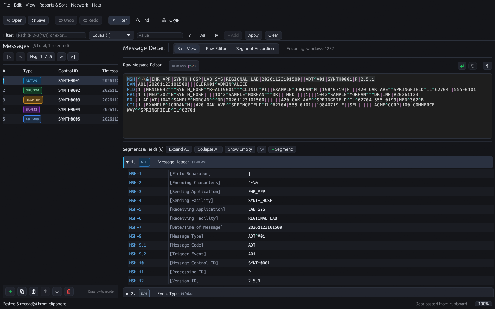

# pipe_wrench

**A fast, responsive desktop and CLI workbench for HL7® v2 (Health Level Seven® Version 2) interface troubleshooting and conversion projects.**

> **⚠️ DISCLAIMER — NO WARRANTY & USE AT YOUR OWN RISK**
>
> **This software is provided "AS IS", without warranty or guarantee of any kind, express or implied.** You use `pipe_wrench`, `pipe_wrench_cli`, and any messages, files, reports, or MLLP transmissions generated or modified by this tool **strictly at your own risk**.
>
> **Do not send unverified output into a production EHR or live clinical environment.** If you use this tool or its output in a production EHR, interface engine, or clinical workflow and it causes data corruption, interface failures, downstream errors, or any other issues, **that is solely your responsibility**. The author(s) and contributors accept **no liability or responsibility** for any damages, outages, or consequences resulting from its use. Always validate outputs in a non-production/test environment before use.
>
> **No Regulatory or Security Certification:** This software is a local desktop and CLI utility and is **not** certified, audited, or attested for HIPAA, HITRUST, SOC 2, or any other regulatory or compliance framework. It makes no compliance claims, and you are solely responsible for ensuring your environment, data handling, and security controls meet your organization's requirements.



---

## What It Does

- **Split-Pane Raw & Structural Inspection**
  - Syntax-highlighted wire view showing active delimiters, escape sequences, and `[CR]`/`[LF]` line endings.
  - Interactive **Segment Accordion** resolving HL7 v2.5.1 / v2.8 field, component, and subcomponent names (`ROL`, `GT1-1..57`, composite types, and Z-segments) with bidirectional cursor sync.
- **Safe Two-Way Editing**
  - Edit fields or components inline (`F2` / double-click) and toggle **`Show Empty`** to populate missing fields without counting pipes.
  - Preview decoded escapes (`\*`), insert or reorder segments, and undo/redo every change (`Ctrl+Z` / `Ctrl+Y`).
  - Lossless raw-byte preservation on all unmodified messages.
- **Fast Multi-Message Filtering**
  - Filter large logs in one row with stacked `AND`/`OR` rules and wildcard repetitions (`PID-3(*).1=123`).
  - Full operator set (`=`, `!=`, `~=` contains, `=~` regex, `>`, `>=`, `<`, `<=`, and `exists`), with non-destructive export or keep-only pruning.
- **Conversion, Batch & Report Tools**
  - Path-targeted Find & Replace with `$1` regex capture groups, plus delimiter and line-terminator conversion.
  - Multi-select CSV/JSON report builder and one-click Base64/`ED` attachment extraction (`OBX-5` PDF, RTF, PNG, JPEG).
  - Deterministic PHI de-identification (`File -> Export Synthetic (Scrub PHI)...` / `Edit -> Scrub PHI in Loaded Messages...`).
- **Built-In MLLP & TLS Testing**
  - Send and receive HL7 messages over MLLP directly from the GUI or CLI, with Original/Enhanced ACKs and optional TLS 1.2/1.3 & mTLS.
  - Automatic outgoing `MSH-10` control-ID rewrite and `MSH-7` timestamp refresh.
- **Single-Binary Portability**
  - Self-contained native executables (`pipe_wrench` GUI + `pipe_wrench_cli` CLI) with a responsive layout that scales from wide monitors down to narrow windows.

---

## CLI (`pipe_wrench_cli`)

Shares the same parser, HL7 dictionary, filter syntax, and MLLP engine for scripted troubleshooting and conversion workflows:

```bash
# Scan directories/archives and summarize message types, apps, and batches
pipe_wrench_cli scan ./messages --ext txt,dat,hl7 --include-archives --group-by type,app,date --check-batches

# Filter messages with wildcard repetitions, contains (~=), regex (=~), and exists
pipe_wrench_cli filter ./inbound --filter "PID-3(*).1=123" --out matched_mrn.hl7
pipe_wrench_cli filter ./inbound --filter-field "PID-3(*).1 ~= 23" --filter-field "ROL-4 exists" --count

# Search with context columns and hit breakdowns
pipe_wrench_cli find ./inbound --field "PID-3(*).1=123" --with "MSH-10,MSH-9,PID-5.1" --summary

# Targeted field/component replace with regex capture groups
pipe_wrench_cli replace ./inbound.hl7 --find "OLD_(\\d+)" --replace "NEW_$1" --field PID-3.1.4 --regex --out updated.hl7

# Export filtered CSV/JSON reports
pipe_wrench_cli report ./batch.hl7 --fields "MSH-10:string,MSH-7:date,ROL-4.2:string,GT1-17.1:string" --filter "ROL-4 exists" --format csv --out report.csv

# Normalize line endings, strip MLLP framing, sort by MSH-7, or convert delimiters
pipe_wrench_cli convert ./batch.hl7 --out normalized.hl7 --term crlf --strip-envelope --sort-msh7

# Deterministically de-identify PHI into referentially-consistent synthetic messages
pipe_wrench_cli scrub ./prod_samples --out ./synthetic.hl7 --seed my-test-seed

# Extract Base64 / HL7 ED attachments (PDF, RTF, PNG, JPEG, etc.) from OBX-5 or custom fields
pipe_wrench_cli extract ./oru_batch.hl7 --out ./extracted_attachments

# Listen and send over MLLP (with optional --tls / mTLS)
pipe_wrench_cli listen --bind 127.0.0.1 --port 7772 --ack generated --ack-code AA --out received.hl7
pipe_wrench_cli send ./outbound.hl7 --host 127.0.0.1 --port 7772 --rewrite-control-id --refresh-timestamp
```

### PHI De-Identification (`scrub`)

> **WARNING — Best-Effort De-Identification Only:** Automated PHI scrubbing CANNOT be 100% guaranteed to detect or remove all Protected Health Information (including custom Z-segments, unstructured clinical notes, or embedded attachments). You are solely responsible for manually inspecting and verifying all scrubbed output before sharing or using it outside a secure environment.

---

## Installation

Download pre-built archives containing both `pipe_wrench` (GUI) and `pipe_wrench_cli` (CLI) for Windows (`x86_64`) and Linux (`x86_64`) from the [GitHub Releases](https://github.com/brett-a-willis/pipe_wrench/releases) page.

To build from source with a stable Rust toolchain:

```bash
cargo build --release --workspace
```

---

## License

Licensed under the [MIT License](LICENSE). This is a personal utility shared as-is without active issue tracking or support.

HL7® and Health Level Seven® are registered trademarks of Health Level Seven International. pipe_wrench is an independent utility and is not affiliated with, endorsed, or sponsored by Health Level Seven International.
